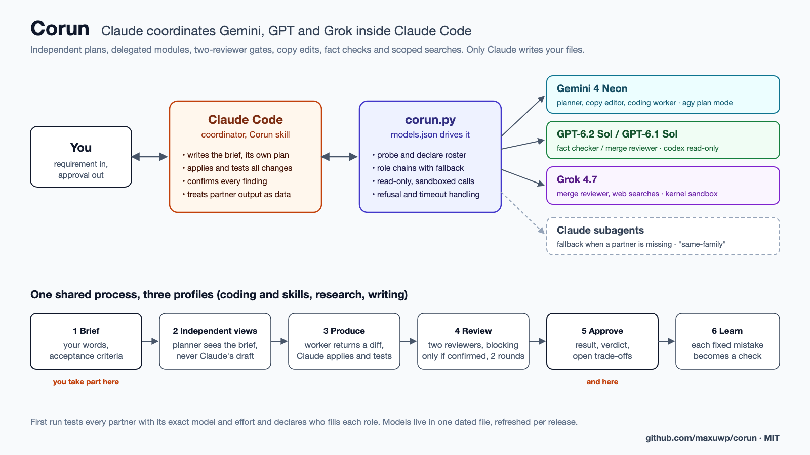

# Corun

A Claude Code skill that lets Claude coordinate work with partner AIs from other vendors. The name sounds like "quorum": a decision passes when independent voices agree.



Claude stays the coordinator. Gemini, GPT and Grok contribute independent plans, self-contained modules, two-reviewer merge gates, copy edits, fact checks and scoped web searches. It works with any subset of these partners and falls back to Claude subagents for missing ones.

## Requirements

- Claude Code.
- Python 3.9 or later (standard library only).
- Any of these command-line tools, signed in with your own subscription:
  - `agy` (Google Antigravity CLI) for Gemini
  - `codex` (OpenAI Codex CLI) for GPT; the copy bundled in the ChatGPT desktop app on macOS is found automatically
  - `grok` (xAI Grok CLI) for Grok

## Install

Copy or clone this folder to `~/.claude/skills/corun/`. Then, in Claude Code, ask for the roster ("corun status"). The first run probes each partner with its exact model and effort and shows which partner fills each role.

## Configuration

- `models.json` defines the partners, models, effort levels, roles and fallback order. To override these settings without modifying the skill, copy `models.json` to `~/.config/corun/models.json` and edit the copy.
- Set `CORUN_CODEX_BIN`, `CORUN_AGY_BIN` or `CORUN_GROK_BIN` to the path of a tool that is not on your `PATH`.
- Local state (the probed partner roster) is stored in `~/.config/corun/roster.json`, and call records are kept for seven days in `~/.cache/corun/runs/`; both stay outside this repository.

## Safety

Only Claude modifies your files. Codex runs read-only with your Codex config (MCP servers, plugins) ignored. Antigravity runs in plan mode with its terminal sandbox. Grok runs in its read-only kernel sandbox with MCP tools denied. Claude reviews and applies every change and treats partner output as data, not instructions.

Known limits: Grok may still write its own state under `~/.grok` and temporary folders, so Corun skips Grok when the project itself is in a temporary folder. Antigravity has no per-call switch for MCP servers, so any MCP server configured in `agy` stays available to it in plan mode.

## Before publishing a fork

```bash
python3 scripts/corun.py scan .
```

The scan fails on home-directory paths, your user name, your git email, email addresses, API keys, tokens and local state files.

## Files

- `SKILL.md`: the process Claude follows.
- `reference/profiles.md`: coding, research and writing profiles.
- `reference/grok-tasks.md`: how to write tasks for the runner role.
- `reference/refresh.md`: updating models after a release.
- `reference/evidence.md`: the dated evidence behind the current role assignment.
- `scripts/corun.py`: partner calls, roster, declaration. `scripts/scan.py`: privacy scan.
- `docs/CUSTOMIZE.md`: changing models, efforts, roles and the process.
- `BACKLOG.md`: planned work.

## Licence

MIT. See `LICENSE`.
